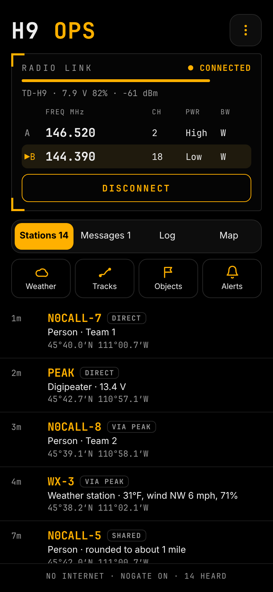
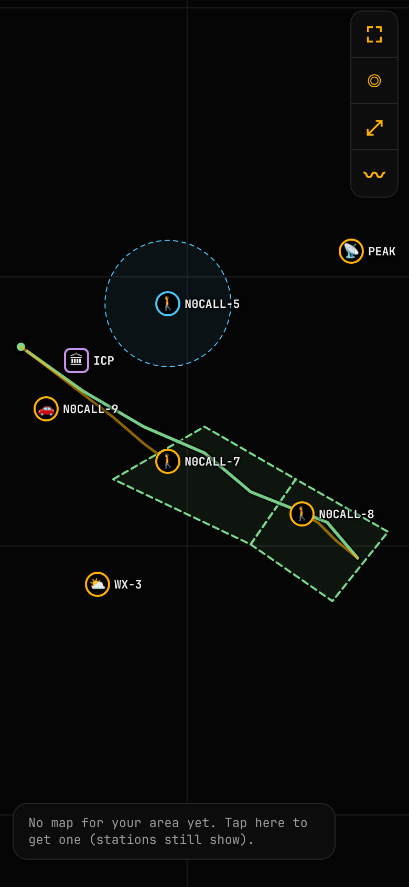
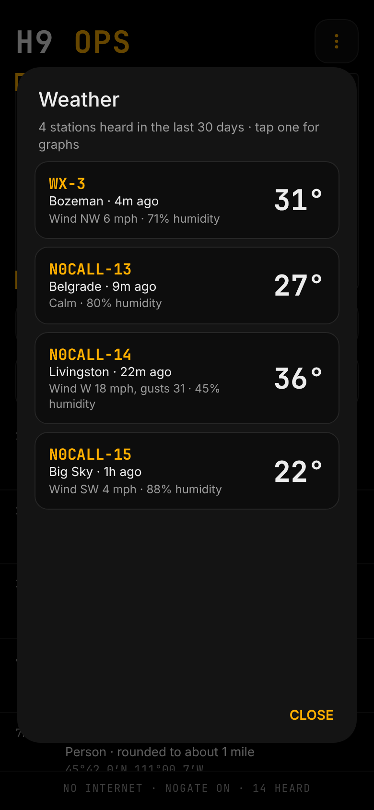
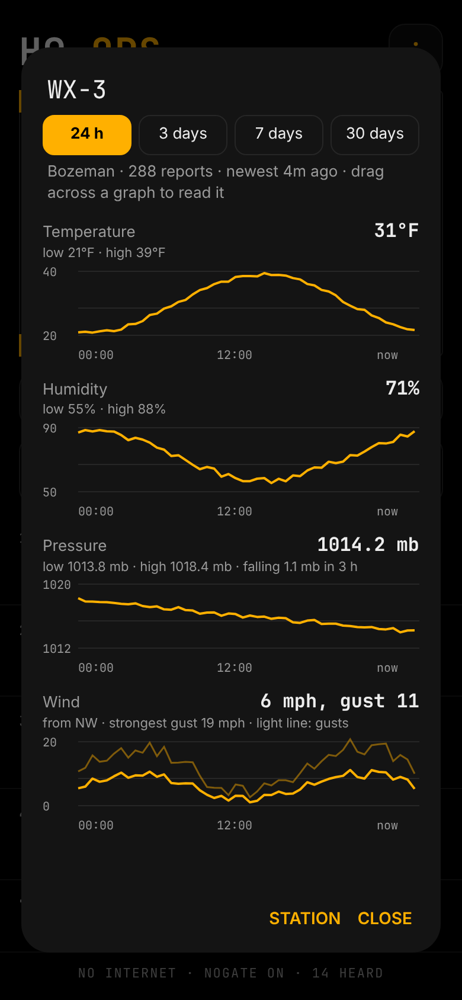
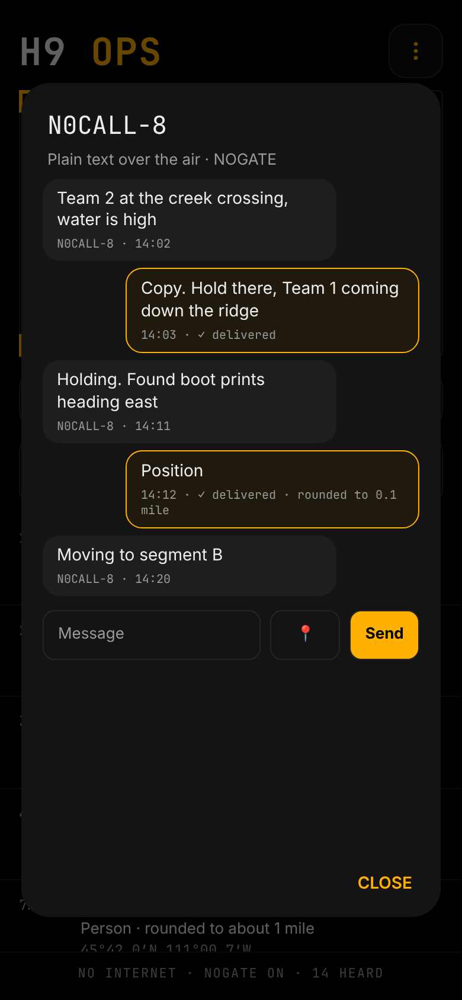
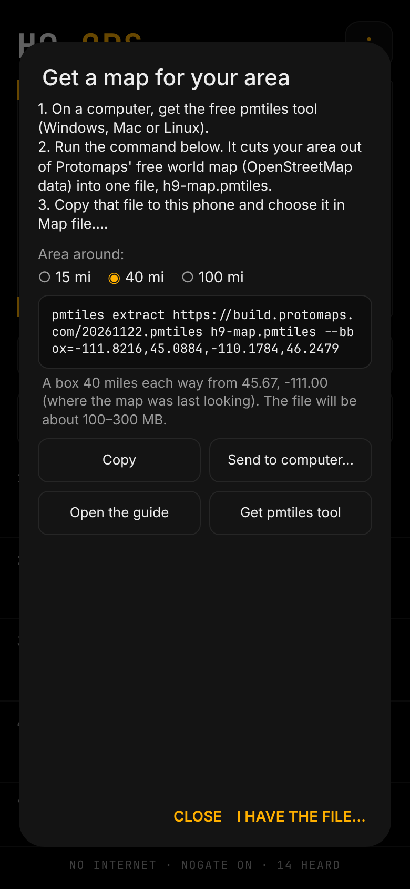

# H9 OPS

**H9 OPS** (H9 Operations Suite) is a small, private Android app for the
TIDRADIO TD-H9 handheld. The radio decodes APRS itself and passes each packet
to the phone over Bluetooth LE; H9 OPS lists the stations it hears, keeps a raw
packet log, shows the radio's battery and channel settings, and sends and
receives APRS text messages through the radio. It also shows stations on an
offline map, keeps weather stations' readings as small graphs, and can send
your position on a smart timer.

Two people with a TD-H9 and this app each can message each other radio to
radio, with acknowledgements, retries and delivery ticks. The app never
beacons (position beaconing stays on the radio): it sends your position only
as a message to one station, when you tap 📍 or on a timer you set.

> [!IMPORTANT]
> **H9 OPS needs custom firmware on the radio: H9 OPS firmware P2.**
> TIDRADIO's stock firmware has no Bluetooth KISS service, so with it the app
> finds the radio but can't connect ("This radio has no KISS service").
> See [Radio firmware](#radio-firmware-p2) below.

<p align="center">




</p>
<p align="center">


</p>
<p align="center"><sub>Made-up stations and places. The map shows the plain grid used before a map file is added.</sub></p>

## Why it works this way

I built H9 OPS for emergency preparedness: for the day the cell towers are
down, the power is out, or you're simply somewhere with no signal, and you
still need to know where your people are and talk to them. Every design choice
comes back to four things.

- **Self-reliance when the grid is down.** Nothing in the app depends on the
  internet, a cell signal, a server or an account. Phone and radio are
  enough: messages go radio to radio, positions come off the air, and the
  map, the weather history and your tracks live on the phone. If it works on
  a good day, it works the same on a bad one.
- **Privacy.** The app has no internet permission at all, so it can't send
  anything anywhere, and nobody has to take my word for that: Android shows
  it on the install screen. No analytics, no ads, no sign-in, no cloud. Your
  data stays on your phone and isn't included in cloud backups.
- **Safety.** You decide when your position leaves the phone: a tap, or a
  timer you set that always has an end time. Positions can be rounded, the
  app never beacons on its own, and messages ask iGates not to put them on
  the internet (NOGATE).
- **Security.** Less to go wrong and less to trust: no third-party code
  besides two small open-source map libraries bundled with the app, offline
  maps instead of a map service that sees where you look, and the source is
  here for anyone to read and build.

The trade-off is a little more setup, such as making your own map file once
(see [MAPS.md](MAPS.md)). That's on purpose: the setup happens while things
are calm, so nothing has to be fetched when they aren't.

## Contents

- [Why it works this way](#why-it-works-this-way)
- [Radio firmware (P2)](#radio-firmware-p2)
- [Install](#install)
- [Getting started](#getting-started)
- [Messaging](#messaging)
- [Map](#map)
- [Weather](#weather)
- [Alerts, objects and bulletins](#alerts-objects-and-bulletins)
- [Privacy](#privacy)
- [More features](#more-features)
- [Building the APK](#building-the-apk)
- [What it decodes](#what-it-decodes)
- [License](#license)
- [Roadmap](ROADMAP.md)

## Radio firmware (P2)

The app talks to the radio through services that only exist in the custom
firmware. **P2** is the firmware this version of the app is built for. It is
based on TD-H9 firmware V1.0.38 and adds:

| Feature | What it does for the app |
|---|---|
| Bluetooth LE KISS TNC | Every APRS packet the radio decodes goes to the phone, and frames from the phone are transmitted on the APRS channel |
| Radio PIN | The radio only transmits for phones that send the PIN first |
| Radio info | Battery voltage, channel A and B frequency, channel number, power, bandwidth, and the APRS switch, read every minute |
| Transmit timing | The transmitter is held for the packet's real length, and TX delays over 500 ms key the radio earlier |
| Bluetooth watchdog | Restarts a stuck Bluetooth link on the radio and reports what it found (developer log) |

It also adds scan speed, APRS mute on channel B, battery percent, and squelch
tail and receive filter options: see [firmware/README.md](firmware/README.md).

**Getting it:** this repository holds no official TIDRADIO firmware. You can use the tid updater and the patched firmware is in the files, look for 1.0.38.P2.fw. You can also make P2 from
TIDRADIO's official V1.0.38 file yourself, offline, with
[`firmware/p2-patcher.html`](firmware/p2-patcher.html) (in a browser) or
[`firmware/patch_p2.py`](firmware/patch_p2.py); both check the file before
and after. If that doesn't work for you,
[ask for the firmware](https://github.com/Deadly447/H9-OPS/issues/new?template=firmware-request.yml)
and I'll send it directly. Steps and flashing:
[firmware/README.md](firmware/README.md).

Flashing any firmware is at your own risk: keep the official file (flashing
it returns the radio to stock), and don't flash a radio you can't afford to
recover.

## Install

**Easiest:** install and update through **Obtainium**, straight from this
repository's releases: [docs/OBTAINIUM.md](docs/OBTAINIUM.md). Or download
the APK from [Releases](https://github.com/Deadly447/H9-OPS/releases).

Requirements:

- Android 8.0 or later, with Bluetooth LE.
- A TD-H9 running H9 OPS firmware P2.
- An amateur radio licence to transmit (listening needs none).

Download `H9-OPS-x.y.z.apk` from the
[latest release](../../releases/latest), open it on the phone and allow the
install when Android asks.

**Automatic updates:** [Obtainium](https://github.com/ImranR98/Obtainium)
(free and open source, on F-Droid) can watch this repository's releases and
install each new version. In Obtainium tap **Add app**, paste this
repository's URL and tap **Add**. The app itself still has no internet
permission; Obtainium does the checking.

## Getting started

1. Turn the radio on.
2. Open H9 OPS, tap **⋮ → Choose radio**, and pick the entry ending in
   **(BLE)**, for example `TD-H9-1234(BLE)`. Don't pair it in Android's
   Bluetooth settings: the radio can't pair, and the app doesn't need it.
3. Tap **Connect**. The radio card turns to *LISTENING* and shows the
   battery and both channels.
4. Check channel B (the APRS channel): **144.390** (North America), **Wide**
   (not Narrow), with the radio's APRS switch on. On Narrow the radio still
   connects but decodes almost nothing. The app reads these settings from the
   radio and warns only when one is wrong.
5. **Stations** shows each station once, newest first: symbol, callsign, how
   long ago, and whether it was heard direct or through a digipeater. Tap one
   for its position, speed, altitude, comment, weather, telemetry and recent
   packets.
6. **Log** shows every packet in order. Tap one for the raw text.

The app keeps listening in the background (there is a notification with a
Stop button) and reconnects by itself if the radio goes out of range or is
switched off and on.

The radio gets a new Bluetooth address every time it powers on. When the
phone sees your radio's name at a new address it asks once, **"It's my
radio"** or **"Not now"**. Say "Not now" if you didn't just restart the radio:
something nearby may be imitating it.

## Messaging

1. Tap **⋮ → Settings** and enter your callsign with an SSID, for example
   `N0CALL-7`. Use a different SSID from the one the radio beacons with, so
   the radio's own APRS doesn't also answer your messages.
2. Open **Messages → New message**, enter the other station's callsign and
   tap **Open**. Type up to 67 characters and tap **→**. Or tap a station in
   the Stations list and press **Message**.
3. The phone hands the message to the radio, and the radio transmits it on
   its APRS channel. When the other station acknowledges it, the message shows
   **✓ Delivered**. Without a reply it is sent again after 30 s, 1, 2 and 4
   minutes (5 times in all), then marked as failed; tap it to send again.
4. Messages to your callsign pop up as a notification and are acknowledged
   automatically, 3 seconds later (the sending TD-H9 can't hear anything for a
   moment right after it transmits). Repeats are acknowledged but shown once.

**Settings:**

- **Path** (default `WIDE1-1`): the digipeater path. `WIDE1-1,WIDE2-1` for
  longer range; empty for direct only.
- **Keep my messages off the internet** (on by default) adds `NOGATE` to the
  path, so iGates that follow the convention don't forward your messages to
  APRS-IS. Not every iGate honours it, and anyone listening on the frequency
  can still read them: APRS is plain text.
- **Quiet mode** (off by default): acknowledge only stations you've
  messaged. An acknowledgement is a transmission, so without quiet mode anyone
  can message your callsign to check you're on the air, and
  direction-finding can locate the reply.

### Send my position

In a conversation, tap **📍** to send your position to that station only. It
takes one fix from the phone's GPS and sends it as a message, not a beacon,
so APRS maps don't plot it.

- **Exact**, or **rounded** to about 0.1, 1, 10 or 60 miles. Rounding snaps the
  position to the centre of a grid cell, so any spot in that cell sends the
  same report.
- The other phone shows it on your station in the Stations list; tapping it
  in the conversation opens it in a map app.
- It is plain text: anyone listening on the frequency can read it. For real
  privacy also turn off the radio's own APRS beacon, or the radio keeps
  broadcasting your exact position.

On the air it looks like `POS 40.0417,-105.2583 1mi @0515z` (rounded) or
`POS 40.04103,-105.26120 @0515z` (exact); the time is when the fix was taken
(UTC).

### Send my position regularly

📍 → **Every…** sends your position to that station every 5, 10, 15 or 30
minutes, or every 1 or 2 hours, or **Smart**, with the same precision choices.

- **🚗 Smart / 🚶 Smart** (SmartBeaconing) send more often when you move and
  rarely when you don't. Driving: the phone checks the GPS every minute and
  sends every 3 minutes at 60 mph or faster, every 6 at 30 mph, every 30 when
  parked, soon after a turn, and once when you stop. On foot: checks every 2
  minutes; every 5 minutes at 4 mph, every 10 at 2 mph, every 30 below 1 mph.
  Checking the GPS this often costs more battery than a fixed timer.

- **Stop** after 1, 4, 12 (default) or 24 hours, or "until I turn it off", so
  a forgotten timer can't keep reporting where you are.
- It runs with the app closed and the screen off, as long as the radio
  connection is on, and the radio notification says who is getting your
  position. Android may delay a wake-up by a few minutes in deep sleep.
- A new position replaces one still waiting for an acknowledgement.
- Each position is a transmission: direction-finding can locate you from
  them, whatever the precision setting says.

## Map

The **Map** tab shows every station with a position on an **offline map**:
amber for beacons, blue for positions shared by message, purple for objects,
with a dashed circle where a position is only approximate. Tap a station for
its details, Navigate, or (for your own objects) Remove. Long-press the map to
place an object, draw an alert area, or navigate there. Buttons: full screen,
my position, fit all stations, and station trails. On the Map tab the radio
card shrinks to one line; tap it to open it.

**The map file.** H9 OPS never downloads maps (it has no internet access). You
make one file for your area on a computer, once: **⋮ → Map file… → Get a map
for your area…** gives you the exact command for a box around where you are,
a button to send it to your computer, and links to the free tool and the
guide. Full steps: **[MAPS.md](MAPS.md)**. Without a map file, stations still
show on a plain grid.

**Terrain.** A second file adds the shape of the ground: hill shading, contour
lines (40 ft zoomed in, with 200 ft index lines) and the elevation under a
crosshair in the middle of the map. **⋮ → Map file… → Get terrain for your
area…** gives the command for [Mapterhorn](https://mapterhorn.com)'s free
elevation data, the same way as the street map. A picture map, such as a USGS
topo map exported as MBTiles, works there too. **⛰** on the map shows or hides
it. Steps: **[MAPS.md → Terrain](MAPS.md#terrain)**.

**Overlays.** **⋮ → Map overlays… → Add file…** draws GPX, KML or KMZ files
(trail plans, search segments, waypoints from CalTopo, Gaia, onX, Google Earth
or ATAK) in green on the map. Tick to show or hide; tap one to zoom to it or
remove it.

## Weather

Weather stations heard on the air are kept for 30 days. **Weather** lists them
as cards: station, nearest town (read from your map file, so no internet),
when it was last heard, wind and humidity, and the temperature. Tap one for
small graphs of temperature, humidity, pressure (with its 3-hour trend), wind
and gusts, and rain over 24 hours, 3, 7 or 30 days; drag across a graph to read
it. Only stations that transmit show up: CWOP stations (CW…, DW… callsigns on
aprs.fi) upload over the internet and are never on the air.

## Alerts, objects and bulletins

- **Alerts:** a notification when a callsign you watch is heard (`N0CALL-*`
  for every SSID), when a station enters or leaves an area you drew on the
  map, or on any emergency packet (its own channel, vibrates).
- **Objects:** long-press the map → **Place an object here…** (command post,
  aid, shelter, team, staging and more). It's resent every 5, 10 or 30
  minutes until you remove it.
- **Bulletins:** 📢 on the Messages tab lists the bulletins heard and sends
  your own, once or repeated for 1 or 4 hours.

## Privacy

- **No internet access at all.** The app doesn't ask for the INTERNET
  permission, so Android won't let it reach any server: no APRS-IS, no
  analytics, no update checks.
- **Data stays on the phone.** Messages, heard packets (30 days), weather
  history, tracks, the map file and overlays are kept in the app's private
  storage, excluded from cloud backup and device-to-device transfer.
- **The map can't reach the internet either.** It runs inside the app and
  answers only its own pages and the map file; any other request is refused.
  Links in Map file… (the guide, the pmtiles tool) open in your browser.
- **Notifications don't show message text on the lock screen.**
- **Location only when you send it.** Bluetooth scanning is declared "never
  for location". The app reads the GPS when you tap 📍, while you record a
  track, or for a timed position you set up yourself (its notification says
  so the whole time). It never asks for "Allow all the time".
- **Nothing is transmitted unless you send something:** a message, a
  position, or the automatic acknowledgement of a message sent to you.
- **Almost no libraries.** The app itself uses only the Android framework.
  The map page bundles two JavaScript libraries, Leaflet and
  protomaps-leaflet (BSD licences, in `app/src/main/assets/map/vendor/`),
  which run offline inside the app.

Limits worth knowing:

- **APRS has no sender check.** Anyone can transmit under any callsign, so a
  message, beacon or position "from" a friend may not be from them.
- **NOGATE is a request.** Most iGates honour it; any listener can still
  upload what they hear.
- **The Bluetooth link to the radio isn't encrypted** (the radio can't pair).
  Someone nearby with a Bluetooth sniffer can see what goes to and from the
  radio, including the radio PIN.

## More features

### Radio info

The radio card at the top shows the link state, the battery (percent, voltage
and a bar) and both channels:

```
RADIO LINK ● LISTENING        62% · 7.74V
TD-H9-1234 · BLE · PIN LOCKED
    FREQ MHz   CH   PWR  BW  USE
▶A  146.520    04   HI   W   TX
 B  144.390    18   LO   W   APRS
[            DISCONNECT            ]
```

▶ and TX mark the selected side (the one PTT transmits on); APRS marks the
channel the APRS receiver is on. Tap the card for the details.

### Radio PIN

Without a PIN, any phone within Bluetooth range can connect to the radio
(when yours isn't connected) and make it transmit. With a PIN set, the radio
transmits only for phones that send the PIN first.

1. **⋮ → Settings → Radio PIN**: type a PIN (4–8 characters) or tap
   **Generate**.
2. Tap **Set on radio…**, then on the radio open **Menu → APRS → APRS Mute**
   and press confirm (keep the same setting). That tells the radio you have
   it in hand.
3. Within a minute, tap **Set**. Enter the same PIN on any other phone that
   should use this radio and tap **Save** (no radio step needed).

To change a forgotten PIN, repeat steps 2–3. After 5 wrong PINs the radio
refuses unlocks until you confirm APRS Mute again or restart it; when the
radio says the PIN is wrong, the app stops sending so retries can't use up
the tries. The PIN is stored sealed by the Android Keystore. Receiving is not
protected by the PIN.

### Recording a track

**Record track** (in ⋮, or **Tracks → Record track**) records this phone's GPS track, and every station
position the radio hears, until you stop it. It needs no signal: phone and
radio are enough. The footer shows **● REC** while it records.

- **Tracks** lists them (date, distance, time, stations heard). Tap one
  to **Export GPX…** (save, or share to a map app: ATAK, CalTopo, OsmAnd,
  Organic Maps and others open it) or to delete it.
- Stations heard at two or more places become their own tracks; the rest are
  waypoints. Positions shared rounded are marked as rounded, never as exact.

### Exports

**⋮ → Export packet log…** saves the newest 1,000 packets, the last 24 hours,
7 days or everything kept (30 days) as text, or **Share…** sends it straight
to another app.

### Developer mode

**Settings → Developer mode** keeps a log for testing the radio and the app:
Bluetooth connection steps and disconnects (with the reason in words), signal
strength, frames sent to the radio, every message's sends, acks and retries,
GPS fix quality, radio PIN replies, and the radio's watchdog counters. Message
text, the PIN and coordinates are never written to it. It stays on the phone
(about 2 MB at most) until you export or clear it: **⋮ → Developer log**.

### Look

Under the radio card are two rows: the tabs (**Stations, Messages, Log, Map**)
and four buttons (**Weather, Tracks, Objects, Alerts**). Everything else is in
**⋮**. **Settings → Tabs and shortcuts…** moves any of them between row 1,
row 2 and ⋮. Clearing stations or messages is at the bottom of Settings.

True black, amber accent, callsigns in JetBrains Mono. **⋮ → Night red**
switches everything to red for use in the dark. The font is bundled under the
SIL Open Font License (`app/src/main/assets/fonts/OFL.txt`).

## Building the APK

With the Android SDK installed:

```sh
./gradlew testDebugUnitTest assembleDebug
# app/build/outputs/apk/debug/app-debug.apk
```

Or open the folder in Android Studio and use *Build → Build APK(s)*.

GitHub Actions (`.github/workflows/build.yml`) runs the tests and builds the
APK on every push. Builds of `main` are signed with the release key from the
repository secrets `KEYSTORE_BASE64`, `KEYSTORE_PASSWORD`, `KEY_ALIAS` and
`KEY_PASSWORD`, and a change of `versionName` in `app/build.gradle` publishes
a release. In a fork without those secrets the APK is signed with a
throwaway debug key and no release is published.

## What it decodes

Plain and compressed positions, Mic-E (with status and altitude), objects and
items, status text, messages, weather reports, telemetry (with the station's
own channel names, units, equations and bit labels from its
PARM/UNIT/EQNS/BITS messages) and third-party (iGate-relayed) packets.
Anything else is shown as raw text in the log.

The decoder lives in `app/src/main/java/io/github/deadly447/h9ops/aprs/` and
has no Android code, so it is unit-tested on its own, including frames
captured from a TD-H9 over Bluetooth.

## License

GNU General Public License v3.0: see [LICENSE](LICENSE).
